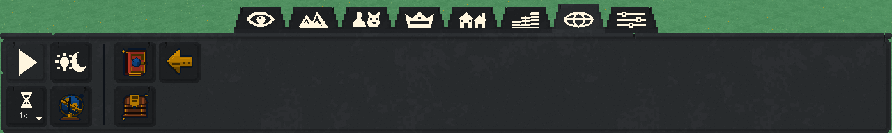
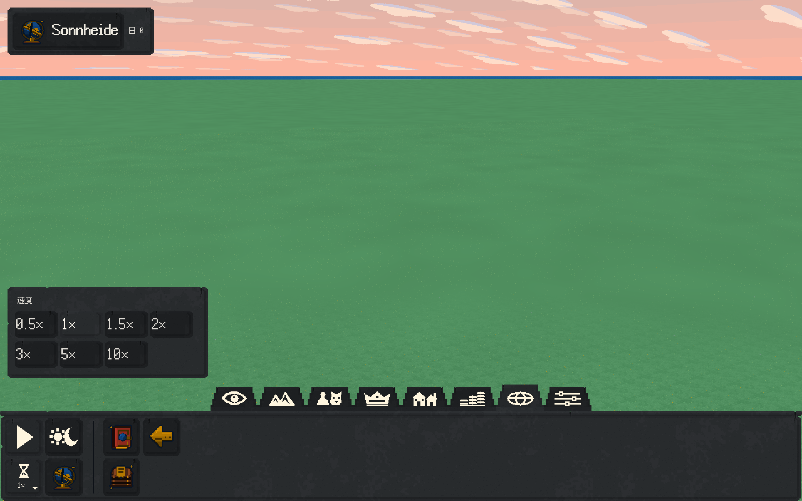
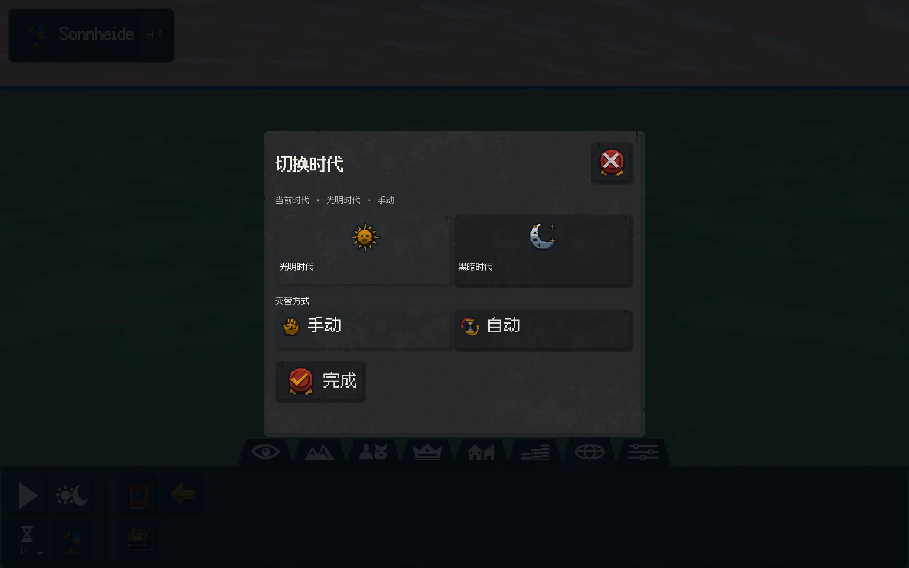
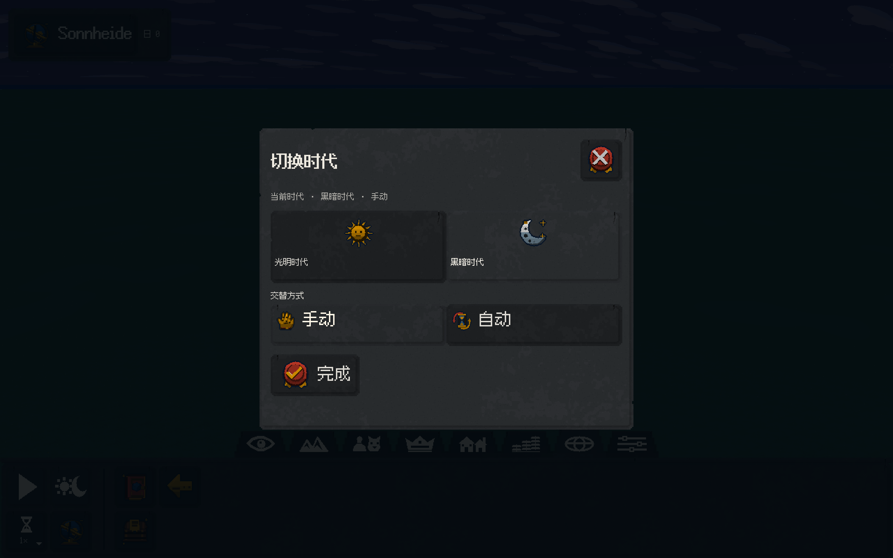

# 双排工具栏交付

2026-10-10 / ADR0026。本批原生实现、统一构建和开发设备GPU验收通过。

## 实际改变

底部工具区固定两排，左侧播放/暂停、折叠速度、时代入口和世界信息在八个分区中位置不变，竖向分隔线隔开右侧分区工具。分类页签压低为38/42dp，宽肩阶梯梯形与连续凸石沿衔接；八个图标重画为48×28原生逻辑格、微黄白色`#fff6df`扁宽剪影，名称保留在三语提示。播放为裸三角，暂停为双竖条。

速度选择器折叠为一个按钮，展开0.5/1/1.5/2/3/5/10七档。所有倍率实际接入整数纳秒/半倍档位调度，暂停选速不继续运行，切速不重算或抹掉已赚的tick余量。选择后、点外部或Escape均可收起，关闭事件不穿透到世界。偏好精确保留半倍档位；旧4倍映射到3倍，旧16/64倍映射到10倍。

时代按钮打开独立居中页面，光明/黑暗及自动/手动一起显示。手动选时代真正原子关闭自动，自动期限继续用原有权威tick与存档余量；页面本身不改世界。错误层、焦点回归、三语与小窗口滚动继续有效。所有窗体和按钮沿用原来的深灰带边缘裂纹石材，31个普通彩色图标与9材质源件逐字节不变。

参考[WorldBox开发者界面原图](https://x.com/Mixamko/status/1575249911507046400)及[官方更新动态截图](https://clan.fastly.steamstatic.com/images/39496096/9fb9f8d9f44fbe37957e84e8b25af22452de4b44.gif)的结构，素材全部由本项目原创配方生成；参考图不进入游戏资源。

## 统一验收

全部修改与交叉审查后执行`python3 tools/build.py --sanitize --native-smoke --bundle --jobs 6`。

|项目|实际结果|
|---|---|
|ALL构建与完整CTest|3/3通过，133.21秒|
|核心检查|71,144项|
|ASan/UBSan|通过|
|真实GPU流程|67操作、35张原生读回帧|
|倍率与状态|七档SDL点击、1.5倍偏好读回、真实播放advance_tick、暂停选速保留暂停|
|时代页面|自动→黑暗→光明→自动→手动实际命令和期限核验|
|布局与输入|八分区固定控制坐标、两排、分隔线；中英德、四视口、双密度；弹层关闭及焦点隔离|
|资产|43图标/129输出，源件与runtime/便携包hash一致；31旧物件和9材质原样保留|

[机器记录](COMPACT_TOOLBAR_DELIVERY.json)、[真实控制与坐标记录](../evidence/compact-toolbar/toolbar-controls.json)、[完整CTest日志](../evidence/compact-toolbar/ctest.log)、[统一验收日志](../evidence/compact-toolbar/acceptance.log)。

双击`Play_Sonnheide.command`或执行`python3 tools/play.py`。本批截图来自原生GPU读回；开发Metal验收不代表Windows GPU/Steam安装已通过。当前阶段尚无生产人物、建筑与后续领域工具，不可用工具仍明确禁用。
