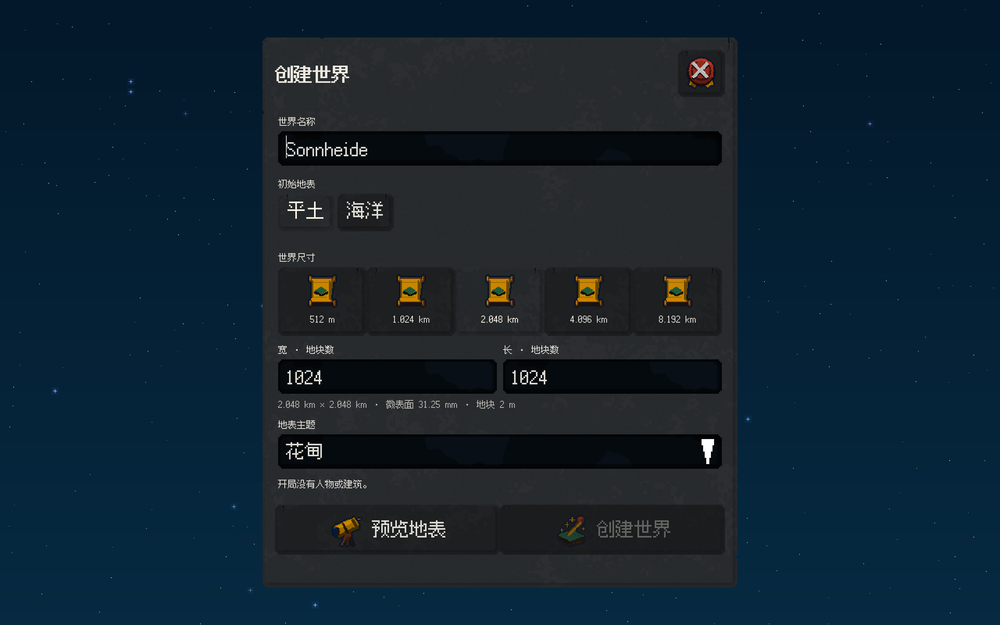
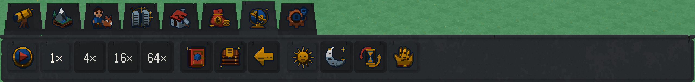
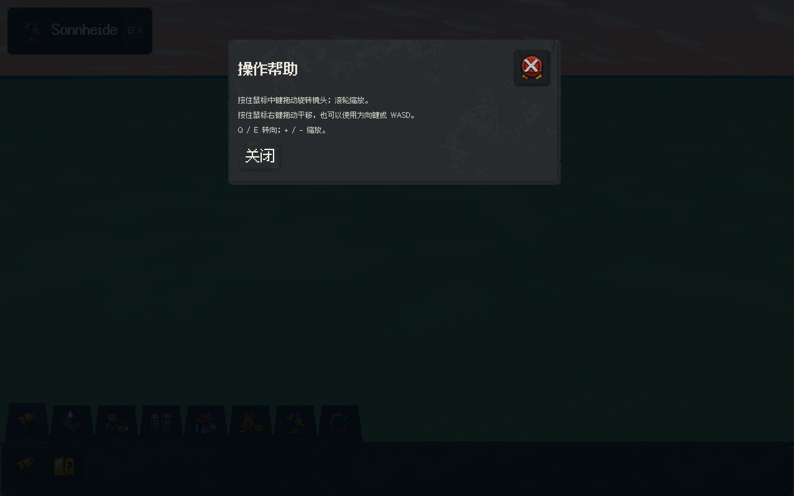
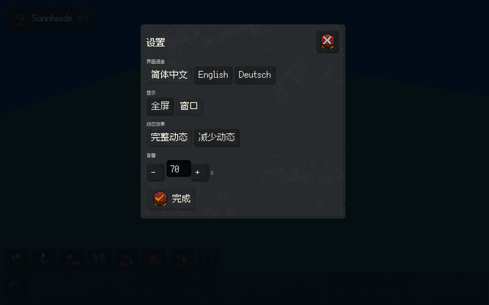
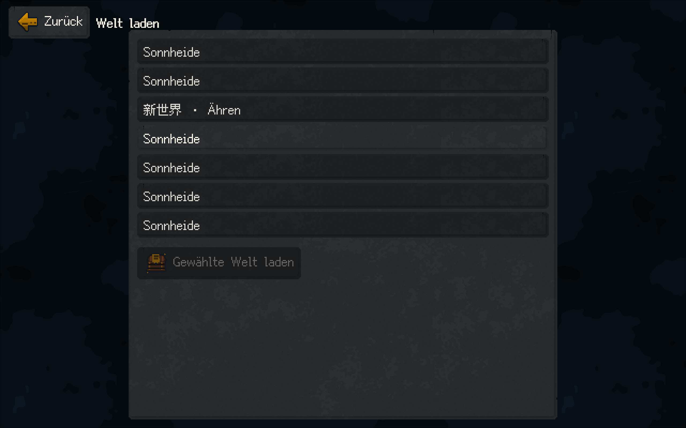
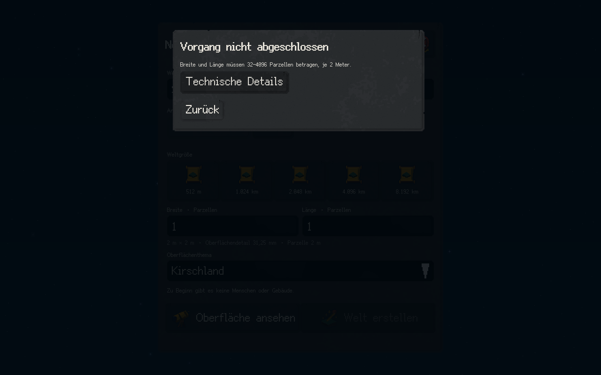

# 深灰石材统一界面交付

2026-10-10 / ADR0025。本批开发设备验收通过。所有窗体与通常按钮已统一使用很深灰色石材，裂纹跟随真实控件边界，深底亮字与同材质交互状态同时接入。

## 交付范围

创建、世界信息、设置、帮助、错误、存档、菜单承托、提示、状态与忙碌面板采用同一512²原创石面。常规执行、关闭、工具、存档条目、选项与分区按钮采用同一石材。输入槽保留黑曜石。原彩色图标不变，另外八种材质源件保留但不再分配为不同窗体底色。

原件实际编码RGB均值[44.310684, 47.310684, 50.310684]、加权亮度均值46.89；该值是原件字节测量，不是物理光度。细颗粒和低对比矿物层次保持高分辨率像素，最近点采样、1纹素/逻辑dp。

窗口裂纹从上缘短距离向内，少量缺口真实裁去几何；小按钮和页签也有短裂，按稳定控件ID选择左右肩，中央内容保持清晰。凹槽及相邻断面使用同色明暗。工具台保留6dp连续凸沿、2dp阴面和其上58/62dp页签。裂纹与UV使用有界缓存几何，纯表现不消耗模拟RNG。

所有石面改深底亮字；默认、hover、focus、selected、active和disabled保持同一石材并可区分。模态层级、键盘操作、草案、三语、小窗口滚动、世界存载和相机行为保持。41图标123件及其它8材质均与父提交逐字节相同。

## 统一验收

全部改动和交叉检查结束后执行`python3 tools/build.py --sanitize --native-smoke --bundle --jobs 6`。

|项目|实际结果|
|---|---|
|全目标构建与完整CTest|3/3通过，130.53秒|
|核心不变量|71,101项|
|ASan/UBSan|完整测试与原生流程通过|
|实际GPU流程|66操作、32张2560×1600读回帧|
|资源与程序包|源件/runtime/便携包材质一致，可执行文件hash一致|
|界面覆盖|中英德、四种视口、1/2密度、模态输入与世界存载回归|

机器记录：[DARK_STONE_DELIVERY.json](DARK_STONE_DELIVERY.json)。[完整CTest日志](../evidence/dark-stone/ctest.log)、[统一验收日志](../evidence/dark-stone/acceptance.log)、[原生操作](../evidence/dark-stone/native-flow.json)。以下PNG为本批原生GPU读回的无损导出。

双击`Play_Sonnheide.command`或执行`python3 tools/play.py`；本地便携包位于`.build/package/Sonnheide`。历史[浅石碑交付](STONE_TABLET_DELIVERY.md)保留当时原件及结果。

本批为开发设备Metal验证。Steam为唯一发行目标；Windows GPU及Steam安装仍待实机验证。人物、建筑与后续模拟按原计划施工。
