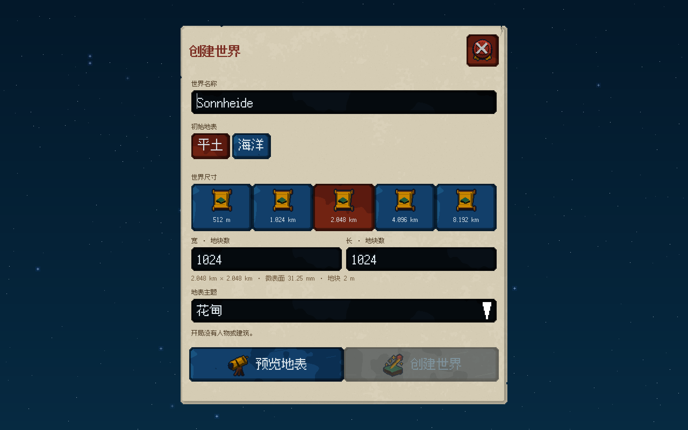
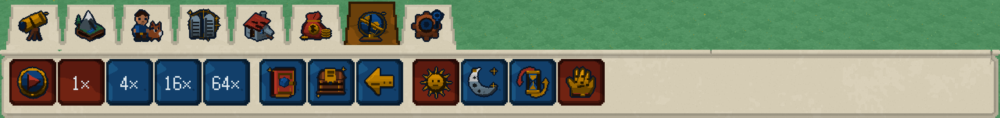

# 浅奶黄石碑界面交付

2026-10-10 / ADR0024。本批开发设备验收通过。界面石材为微微泛黄的浅色完整石碑，大面保持干净；边缘仅有少量实际缺口与从上缘向内延伸的短裂纹。

## 实际交付

512²原创石面使用低饱和奶黄有限色板，最近点采样、1纹素/逻辑dp；纹理内无碎石分块、横纹或平铺裂缝。实际编码RGB均值为[213.279114, 204.280518, 180.389759]，加权亮度均值204.47、标准差1.61。这些仅为原件字节测量，不是物理光度。

缺口与短裂纹按每个控件的真实边界生成，在缓存网格内裁出少量轮廓缺损，中央石面保持完整。工具台有连续6dp凸石沿和2dp温灰阴面，八个页签的脚底恰接沿顶；不挖沿、不重叠涂画。阴面表现石头厚度，避免纯白亮条和深黑工业边框。

创建窗、世界信息页和其它浅石面正文使用深棕墨色，标题深红实际粗体，取消浅底黄白轮廓。按钮、输入槽及其它八种深色材质保持各自可读配色。其它八种纹理和41图标123件原件与上一提交逐字节相同。旧大理石生产纹理和绑定已移除；源码、runtime和便携包的实际材质一致。

## 统一验收

全部新源件完成后执行：`python3 tools/build.py --sanitize --native-smoke --bundle --jobs 6`。

|证据|实际结果|
|---|---|
|ALL原生目标、完整CTest|3/3通过，128.82秒|
|核心不变量|71,101项检查|
|ASan/UBSan|完整测试与原生流程通过|
|真实GPU流程|66个操作、32张2560×1600读回帧|
|实际纹理|9材质、最近点采样；源件/runtime/便携包一致|
|布局与交互|中英德、四种窗口尺寸、密度1/2；凸石沿/页签关系、实际编译缓存、模态输入和存载回归|

机器记录：[STONE_TABLET_DELIVERY.json](STONE_TABLET_DELIVERY.json)。[完整CTest日志](../evidence/stone-tablet/ctest.log)、[统一验收日志](../evidence/stone-tablet/acceptance.log)、[原生操作](../evidence/stone-tablet/native-flow.json)、[GPU记录](../evidence/stone-tablet/physical-ui-gpu.json)。下列PNG为本批原生GPU读回的无损导出。

双击`Play_Sonnheide.command`或执行`python3 tools/play.py`即可试玩；便携包位于`.build/package/Sonnheide`。历史[实物界面交付](PHYSICAL_PIXEL_DELIVERY.md)保留当时原件和测试结果。

本批为开发设备Metal验证；唯一发行平台Steam，Windows GPU与Steam安装仍待实机验收。人物、建筑与后续模拟仍按原计划交付。
